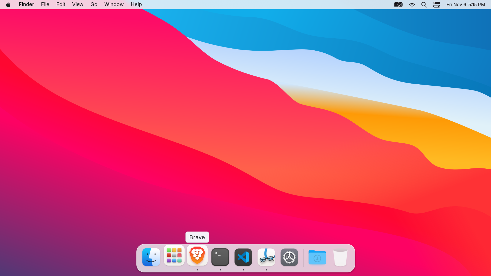
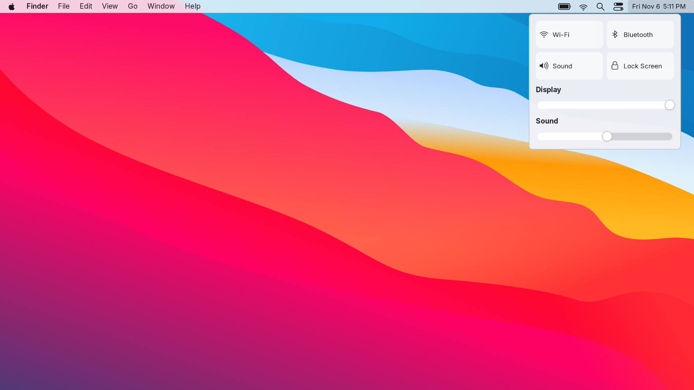
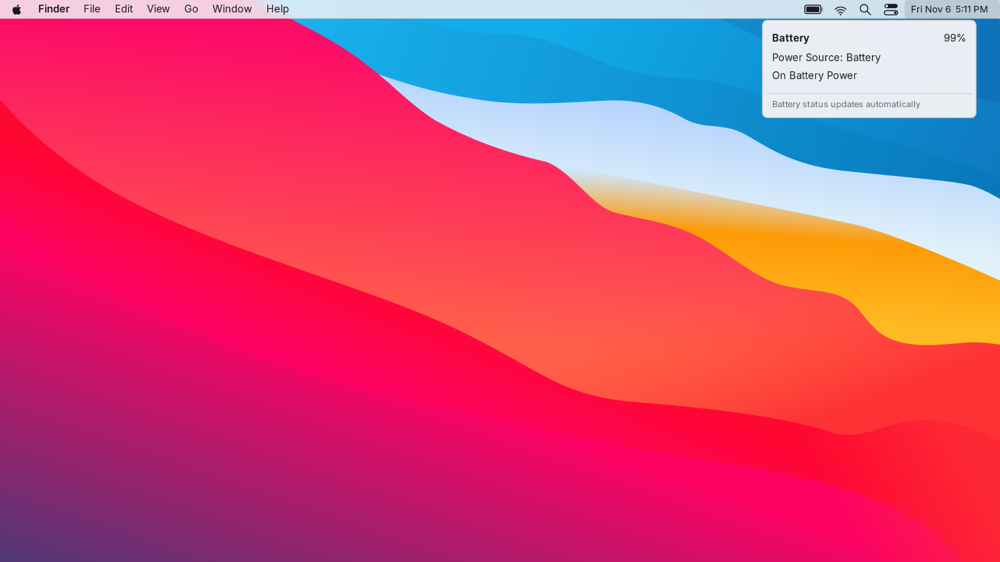
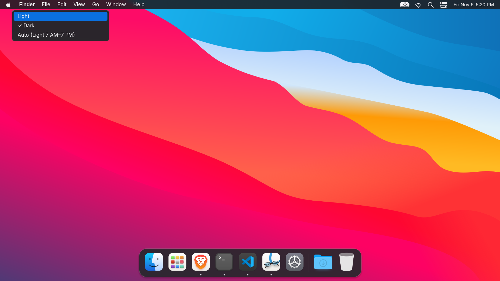

<div align="center">

# macOS-style Arch Linux

An Apple-style menu bar, translucent dock, WhiteSur icons and floating windows
for Arch Linux and Hyprland.

[Install](#install) · [Shortcuts](#shortcuts) · [Guide](docs/REFERENCE.md) · [Credits](docs/THIRD-PARTY.md)

</div>


## The desktop

- **Menu bar:** dedicated GTK/Cairo bar with a pale frosted surface, dark text, smoothly drawn status icons, matching dropdowns and a Control Center with working sound/brightness sliders. Battery updates follow real charging/adapter states; click it for percentage, power source and charging status. Sound and Bluetooth live in Control Center.
- **Dock:** shows apps open on the current desktop, with running indicators, plus Launchpad and Trash shortcuts. It updates as windows open, close or move between desktops; clicking an app focuses a window on this desktop. Minimized windows remain available in their original desktop’s dock. Auto-hides until you hover at the bottom edge or press `Super + Alt + D`.
- **Appearance:** WhiteSur Dark GTK 3/4 styling, WhiteSur icons and cursors, Big Sur-style wallpaper, and Inter UI typography.
- **Windows:** floating by default, rounded corners, shadows and desktop blur.
- **Tools:** searchable Launchpad-style app grid, clipboard history, screenshots, Wi-Fi, Bluetooth and audio controls.

This is a desktop configuration for **Arch Linux**, not a bootable OS image or
native macOS. Inter substitutes for Apple's San Francisco. The menu bar supplies
shortcut actions rather than exporting every application's native menus. Linux
apps retain their own title-bar behavior; styling varies across GTK, Qt and Electron.







## Install

Requires **Arch Linux x86_64, Hyprland 0.57.x, internet and sudo**. Run as your
regular user:

```bash
bash <(curl -fsSL https://raw.githubusercontent.com/yadavayush834/arch-hyprland-dotfiles/main/bootstrap.sh) --desktop-only
```

This updates Arch, installs desktop dependencies and pinned upstream WhiteSur
themes, backs up replaced files, and applies this configuration. Log out and back
in afterward. Existing personal monitor rules are replaced with automatic monitor
configuration; adjust the Lua file for your displays.

To inspect the plan first, add `--dry-run`. For a local install:

```bash
git clone https://github.com/yadavayush834/arch-hyprland-dotfiles.git
cd arch-hyprland-dotfiles
./install.sh --desktop-only --dry-run
./install.sh --desktop-only
```

Options:

| Option | Behavior |
| --- | --- |
| `--desktop-only` | Desktop packages and themes; skip developer and office apps |
| `--config-only` | Configuration only; assumes fonts and WhiteSur themes are already installed |
| `--no-activate` | Write files without restarting daemons or setting live GSettings |
| `--dry-run` | Show the plan without changing anything |
| `--no-projects` | Skip example projects when using the full installation |

Without `--desktop-only`, the original full workstation installer also installs
Brave, VS Code, office/creative apps, development tools and example projects.
Launchpad opens installed applications; desktop-only users can install their
preferred browser and editor separately.

## Light and dark appearance

Choose **Apple menu → Appearance…** or **Control Center → Appearance…**, then select **Light**, **Dark**, or **Auto**. Changes apply live to the bar, dock, menus, Launchpad, GTK apps, terminal, notifications and supported app palettes. Auto uses Light from 7 AM to 7 PM, Dark overnight. Your choice is saved across logins. Some applications need reopening to adopt their new theme. Window title bars follow the same Light/Dark choice.



## Sound effects

Big Sur notification, volume-key and screenshot effects are downloaded locally by the installer. Open **Control Center → Sound Effects…** to preview, enable or disable them. Effects play at 35% relative volume and respect output mute; repeated events are rate-limited. The sound files are not bundled in this repository.

## Shortcuts

**Super** means your keyboard's Windows/logo key (shown as ⌘ in the shortcut menu).

| Action | Keys |
| --- | --- |
| Launchpad / Terminal / Finder-style file manager | `Super + Space` / `Super + Return` / `Super + E` |
| Toggle dock | `Super + Alt + D` |
| Window switcher / close window | `Super + Tab` / `Super + W` |
| Next / previous tab in the focused window | `Alt + Tab` / `Alt + Shift + Tab` |
| Move / resize a window | `Super + left drag` / `Super + right drag` |
| Switch desktop / send window to desktop | `Super + 1–9` / `Super + Shift + 1–9` |
| Toggle floating / keyboard focus | `Super + Shift + Space` / `Super + arrows` |
| Wallpaper / controls / Wi-Fi | `Super + Alt + W` / `Super + Alt + B` / `Super + Alt + N` |
| Screenshot screen / area / options | `Super + Shift + 3` / `Super + Shift + 4` / `Super + Shift + 5` |
| Copy screenshot only | Add `Ctrl` to the screen/area shortcuts |
| Clipboard history / lock | `Super + V` / `Super + L` |

Screenshot options include active-window capture and a five-second timer. Files save in `~/Pictures/Screenshots` and also copy to the clipboard. `Print` still selects an area; Escape cancels. To move windows to workspaces 3–5, use `Super + Alt + Shift + 3/4/5` (the screenshot shortcuts take priority).

The wallpaper picker preserves the fixed Mac-style system colors.

## Restore

```bash
~/.local/bin/arch-rice-restore
```

This restores the last installer backup, including saved GSettings when run in a
desktop session. Log out and back in afterward. Installed theme resources,
packages and generated projects remain installed. See the [guide](docs/REFERENCE.md).

## Validation and credits

`bash scripts/check.sh` checks syntax, portable paths and an isolated repeat
install/restore with a different username. The desktop was checked visually on
Hyprland 0.57.1. The full privileged install has not been tested on a second clean
Arch machine.

Configuration and original helpers: [MIT](LICENSE). WhiteSur styling and wallpaper:
[vinceliuice](https://github.com/vinceliuice/WhiteSur-gtk-theme).
[Full upstream credits and licenses](docs/THIRD-PARTY.md).

Desktop-wide traffic lights are provided by the official Hyprland **hyprbars** plugin, compiled locally against your installed headers. VS Code uses its native title bar, and Qt client decorations are disabled. Brave keeps its integrated WhiteSur controls. After upgrading Hyprland, rebuild with `bash scripts/install-window-controls.sh` and log in again; the pinned plugin source currently targets 0.57.x.
