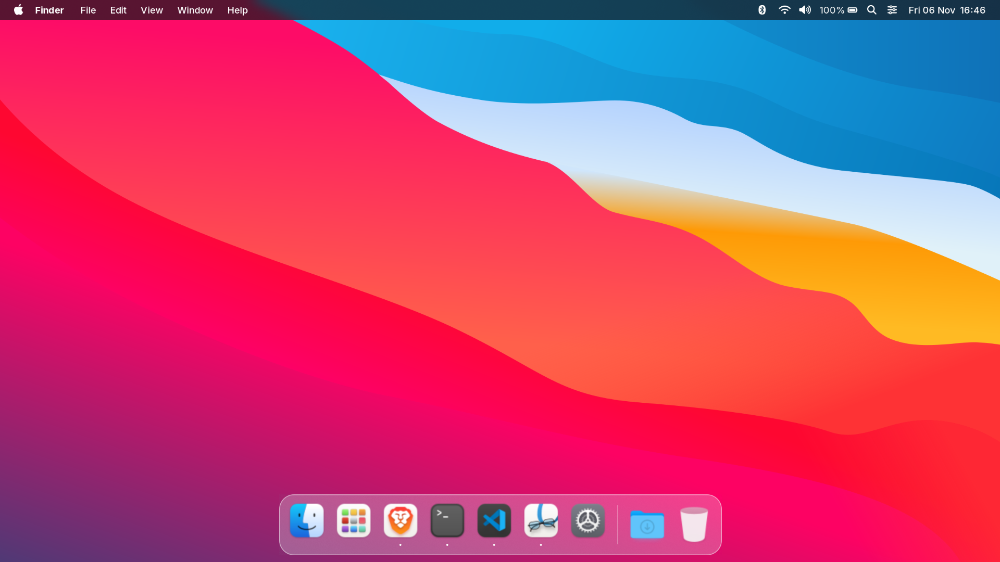
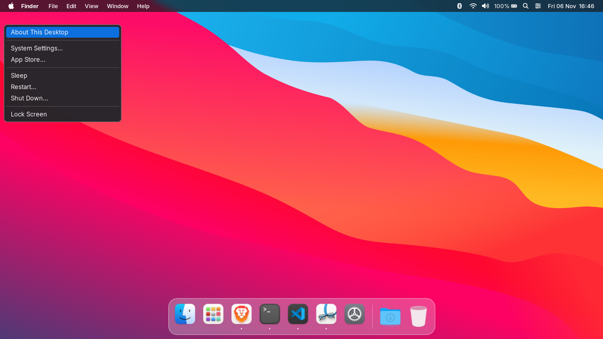

<div align="center">

# macOS-style Arch Linux

An Apple-style menu bar, translucent dock, WhiteSur icons and floating windows
for Arch Linux and Hyprland.

[Install](#install) · [Shortcuts](#shortcuts) · [Guide](docs/REFERENCE.md) · [Credits](docs/THIRD-PARTY.md)

</div>



## The desktop

- **Menu bar:** Apple menu, active application name, shortcut menus, compact status icons and right-aligned date.
- **Dock:** Finder-style file manager icon, Launchpad, browser, Terminal, Code, Preview-style PDF viewer, settings, Downloads and Trash. Running apps have indicators; clicking focuses or launches them.
- **Appearance:** WhiteSur Dark GTK 3/4 styling, WhiteSur icons and cursors, Big Sur-style wallpaper, and Inter UI typography.
- **Windows:** floating by default, rounded corners, shadows and desktop blur.
- **Tools:** Spotlight-style launcher, clipboard history, screenshots, Wi-Fi, Bluetooth and audio controls.

This is a desktop configuration for **Arch Linux**, not a bootable OS image or
native macOS. Inter substitutes for Apple's San Francisco. The menu bar supplies
shortcut actions rather than exporting every application's native menus. Linux
apps retain their own title-bar behavior; styling varies across GTK, Qt and Electron.



## Install

Requires **Arch Linux x86_64, Hyprland 0.57+, internet and sudo**. Run as your
regular user:

```bash
bash <(curl -fsSL https://raw.githubusercontent.com/yadavayush834/arch-hyprland-dotfiles/main/bootstrap.sh) --desktop-only
```

This updates Arch, installs desktop dependencies and pinned upstream WhiteSur
themes, backs up replaced files, and applies this configuration. Log out and back
in afterward. Existing personal monitor rules are replaced with automatic monitor
configuration; adjust the Lua file for your displays.

To inspect the plan first, add `--dry-run`. For a local install:

```bash
git clone https://github.com/yadavayush834/arch-hyprland-dotfiles.git
cd arch-hyprland-dotfiles
./install.sh --desktop-only --dry-run
./install.sh --desktop-only
```

Options:

| Option | Behavior |
| --- | --- |
| `--desktop-only` | Desktop packages and themes; skip developer and office apps |
| `--config-only` | Configuration only; assumes fonts and WhiteSur themes are already installed |
| `--no-activate` | Write files without restarting daemons or setting live GSettings |
| `--dry-run` | Show the plan without changing anything |
| `--no-projects` | Skip example projects when using the full installation |

Without `--desktop-only`, the original full workstation installer also installs
Brave, VS Code, office/creative apps, development tools and example projects.
The dock opens installed applications; desktop-only users can install their
preferred browser and editor separately.

## Shortcuts

**Super** means your keyboard's Windows/logo key (shown as ⌘ in the shortcut menu).

| Action | Keys |
| --- | --- |
| Spotlight / Terminal / Finder-style file manager | `Super + Space` / `Super + Return` / `Super + E` |
| Window switcher / close window | `Super + Tab` / `Super + W` |
| Move / resize a window | `Super + left drag` / `Super + right drag` |
| Switch desktop / send window to desktop | `Super + 1–9` / `Super + Shift + 1–9` |
| Toggle floating / keyboard focus | `Super + Shift + Space` / `Super + arrows` |
| Wallpaper / controls / Wi-Fi | `Super + Alt + W` / `Super + Alt + B` / `Super + Alt + N` |
| Screenshot / clipboard / lock | `Print` / `Super + V` / `Super + L` |

The wallpaper picker preserves the fixed Mac-style system colors.

## Restore

```bash
~/.local/bin/arch-rice-restore
```

This restores the last installer backup, including saved GSettings when run in a
desktop session. Log out and back in afterward. Installed theme resources,
packages and generated projects remain installed. See the [guide](docs/REFERENCE.md).

## Validation and credits

`bash scripts/check.sh` checks syntax, portable paths and an isolated repeat
install/restore with a different username. The desktop was checked visually on
Hyprland 0.57.1. The full privileged install has not been tested on a second clean
Arch machine.

Configuration and original helpers: [MIT](LICENSE). WhiteSur styling and wallpaper:
[vinceliuice](https://github.com/vinceliuice/WhiteSur-gtk-theme).
[Full upstream credits and licenses](docs/THIRD-PARTY.md).
