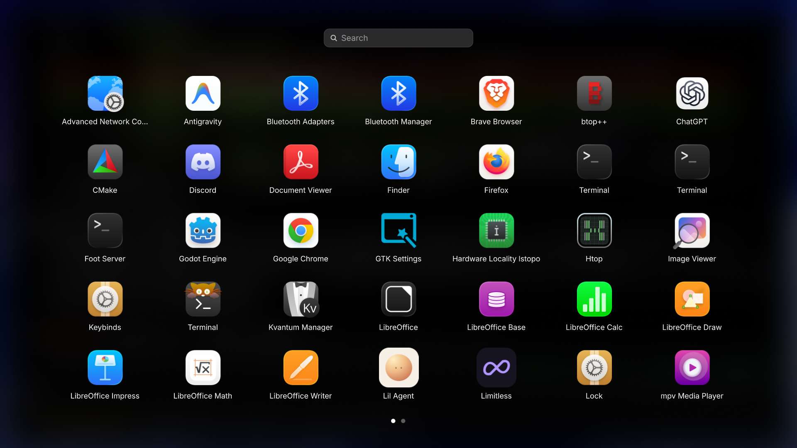

# orchard

**macOS 26 (Tahoe) on Arch + Hyprland 0.57, written from scratch as one Quickshell process.**



## What it does

| | |
|---|---|
| **Menu bar** | Transparent over the wallpaper (text turns dark on bright pictures), Apple menu, bold app name, File/Edit/View/Window/Help menus that really work: they send each app the shortcut it understands. Move across titles with a menu open to switch menus, ←/→/↑/↓/↩ to navigate. Tray icons, Now Playing, Focus, battery, Wi-Fi, Spotlight, Control Center, clock. |
| **Control Center** | Wi-Fi, Bluetooth, Airplane Mode, Focus (Do Not Disturb), Dark Mode (right-click for Auto), Display brightness + Night Shift, Sound + output picker, Now Playing, Screenshot, Low Power, Caffeinate, Lock. |
| **Menu extras** | Wi-Fi list with inline password entry, Battery (time left, health, Energy Mode), Sound output, Now Playing with seek bar. |
| **Notifications** | The shell is the notification daemon: glass banners slide in at the top right (hover to keep them), actions, images. Click the clock for Notification Center with Calendar and Batteries widgets. |
| **Dock** | Glass shelf, cosine magnification, running dots, launch hop, name tooltips, minimised windows go to the right side, Downloads, Trash (full/empty). Right-click: window list, Keep in Dock / Remove, Show All Windows, Hide, Quit. Auto-hide and size in System Settings. |
| **Spotlight** ⌘Space | Apps, calculator, system actions, files (fd), web search, clipboard history. ⌘1–4 switch to a single source, ⌘↩ reveals a file in Finder. |
| **Launchpad** F4, ⇧⌘A, Dock | Paged app grid over a blurred desktop, type to filter. |
| **Mission Control** ⌘↑, ⌃↑, F3, 3/4-finger swipe up | Live window previews fly into a grid; Spaces bar on top; drag a window onto a desktop to move it. |
| **App switcher** ⌘Tab | Apps in recent order; hold ⌘, Tab/⇧Tab to move, Q to quit, H to hide, release to switch. |
| **Window management** | Windows float and open centred like on a Mac, with squircle corners and soft shadows. Window menu and ⌃⌥ F / C / ← / → for Fill, Center and Left/Right halves (macOS Sequoia tiling). ⌘M minimise, ⌘H hide, ⌘Q quit, ⌃⌘F full screen. |
| **System Settings** ⌥⌘, | Wi-Fi, Bluetooth, Notifications, Sound, Focus, General, Appearance (Auto/Light/Dark, reduce motion, text size), Desktop & Dock, Displays, Wallpaper, Battery, Keyboard, Lock Screen. |
| **System dialogs** | About This Mac (real hardware), Force Quit (⌥⌘⎋), Restart / Shut Down / Log Out with the 60 s countdown, Keyboard Shortcuts sheet (⌥⌘/), ⇧⌘5 screenshot toolbar. |
| **Screenshots** | ⇧⌘3 / ⇧⌘4 (add ⌃ for clipboard only), named `Screenshot … at 11.05.32 PM.png`, shutter sound, floating thumbnail at the bottom right (click to mark up). |
| **Hot corners** | Top-left Mission Control, bottom-left Launchpad, bottom-right Show Desktop. |
| **Look** | MacTahoe GTK, icons, Kvantum and cursors (vinceliuice); Tahoe Dynamic Desktop wallpaper that crossfades day/night; light/dark switches GTK, Qt, icons and the terminal together. Fonts: SF Pro if installed, otherwise Inter with macOS-style grayscale rendering; web pages asking for `-apple-system` get the same. |
| **Lock screen** | hyprlock: blurred wallpaper, date + large time at the top, avatar, name and glass password field at the bottom. |

## ⌘ shortcuts

⌘ is the Super key. ⌘C/V/X/Z/A/F/S/T/N/W/O/P/R/L/… go to the focused app as Ctrl (Ctrl+Shift in terminals), so copy/paste works the Mac way everywhere. ⌥←/→ jumps words, ⌘←/→ jumps to line start/end, ⌘[ / ⌘] go back/forward.

Changed from zero: lock is now ⌃⌘Q (⌘L focuses the browser address bar), brightness is ⌥⌘= / ⌥⌘- (this laptop's F11/F12 are disabled), terminal stays ⌘Return.

## Install / switch

```bash
./install.sh                 # themes, wallpapers, then switches the desktop
./orchard-switch zero        # back to the zero rice
./orchard-switch orchard     # and back again
```

Traffic-light title bars on every window need the hyprbars plugin built for your Hyprland:
`~/.config/orchard/bin/build-hyprbars`. GTK apps already draw Mac buttons through MacTahoe.

## Layout

```
config/orchard/shell/     Quickshell config (services/ singletons, modules/ surfaces, components/)
config/orchard/hypr/      hyprland.lua + optional titlebars.lua
config/orchard/bin/       start, appearance, shot, term, sound, night, textsize, lockprep, build-hyprbars
systemd/                  orchard-shell, orchard-foot, orchard-idle, orchard-clipboard
```

Unaffiliated with Apple. Themes and wallpapers are downloaded from their upstream projects, not bundled.
