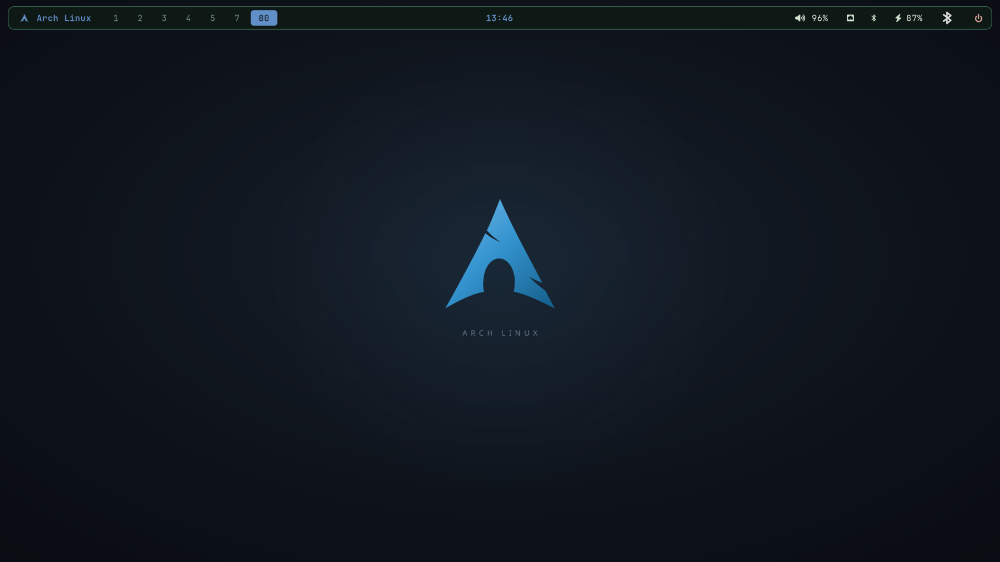
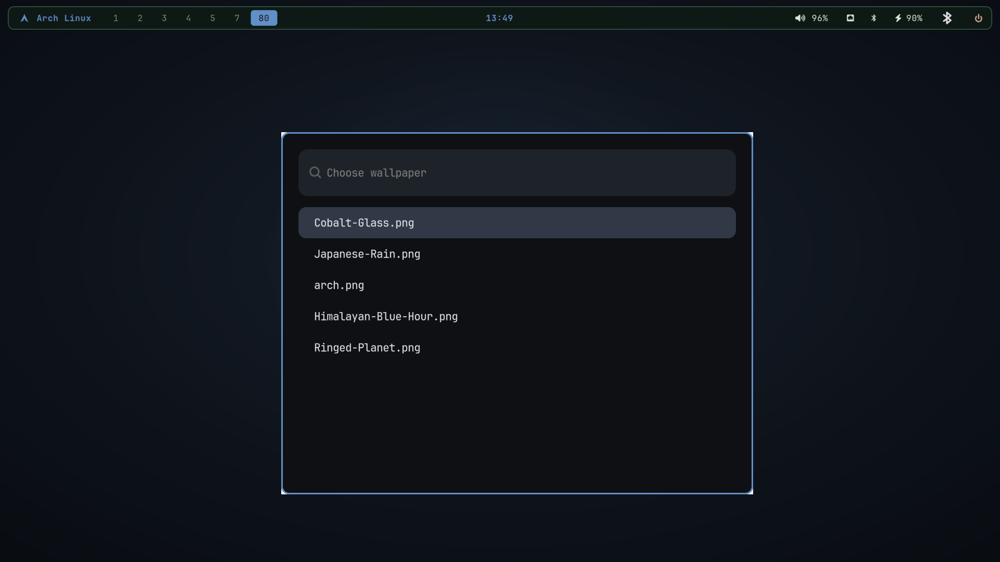

<div align="center">

# Arch Linux · Hyprland

A clean, keyboard-driven Arch desktop with wallpaper-aware colors, six Waybar
styles, useful apps and a ready-to-code development environment.

[Install](#install) · [Features](#whats-included) · [Shortcuts](#shortcuts) · [Full guide](docs/REFERENCE.md)

</div>



## Install

On **Arch Linux x86_64 with Hyprland 0.57+**, an internet connection and sudo,
run this in a terminal as your normal user:

```bash
bash <(curl -fsSL https://raw.githubusercontent.com/yadavayush834/arch-hyprland-dotfiles/main/bootstrap.sh)
```

The installer updates Arch, installs the desktop, apps and developer tools, then
backs up and applies the settings. It asks for your sudo password and may download
several gigabytes. Log out and back in when finished. If `curl` is missing, run
`sudo pacman -Syu curl` first.

Preview the install by adding `--dry-run` to the command. Other useful options are
`--desktop-only`, `--config-only` and `--no-projects`. See the [full guide](docs/REFERENCE.md)
for details, backup and recovery, and how to review the code before running it.

## What's included

- **Desktop:** Hyprland, Waybar, Wofi, Kitty, Dolphin, a lock screen and clipboard history.
- **Make it yours:** four generated wallpapers, six bar styles and colors that follow your wallpaper.
- **Everyday apps:** Brave, VS Code, LibreOffice, Okular, Kdenlive, GIMP and Inkscape.
- **Development:** Git, Node.js, Python, Rust, C/C++ tools, and React and Next.js starters with ESLint.
- **Connectivity:** Wi‑Fi and Bluetooth launchers, a Bluetooth bar button, and PipeWire audio.



## Shortcuts

**Super** is the Windows/logo key. Open **Keyboard Shortcuts** from the app
launcher, or press **Super + F1**, for the complete guide.

| Action | Keys |
| --- | --- |
| App launcher / terminal / close window | `Super + Space` / `Super + Enter` / `Super + W` |
| Wallpaper / Waybar style | `Super + Alt + W` / `Super + Alt + B` |
| Wi‑Fi / Bluetooth | `Super + Alt + N` / click the Bluetooth bar icon |
| Switch / move between workspaces | `Super + 1–9` / `Super + Shift + 1–9` |
| Focus / move / resize a window | `Super + arrows` / `Super + left drag` / `Super + right drag` |
| Float a window / change split | `Super + Shift + Space` / `Super + J` |
| Screenshot / clipboard / lock | `Print` / `Super + V` / `Super + L` |

Open multiple apps on the same workspace and Hyprland tiles them automatically.

## Wi‑Fi and Bluetooth

Click the network or Bluetooth icon in the bar, or search **Wi-Fi** or
**Bluetooth** in the launcher. Wi‑Fi opens `nmtui` if NetworkManager is active;
on an `iwd` system it opens an interactive prompt with connection instructions.
Bluetooth opens Blueman for pairing.

The installer includes the tools but leaves network services under your control.
On a system using `systemd-networkd`, enable iwd and Bluetooth if needed:

```bash
sudo systemctl enable --now iwd bluetooth
```

If NetworkManager already manages Wi‑Fi, keep its existing backend. The installer
does not switch network managers or configure your network credentials.

## Restore

Configuration files are backed up before installation. To restore the latest
backup, run `~/.local/bin/arch-rice-restore`, then log out and back in. This
restores configuration; installed packages and projects remain in place.

The configuration-only install and restore have been tested in an isolated home;
the full installer has not yet been tested on a second clean Arch machine.
[Full guide](docs/REFERENCE.md) · [MIT License](LICENSE)
