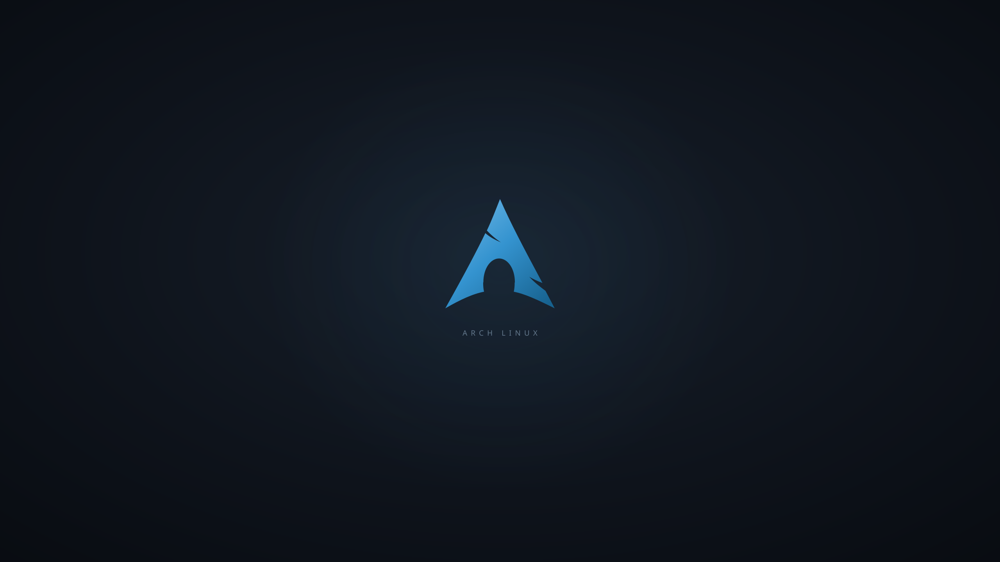

# Arch Linux · Hyprland dotfiles

Ayush's graphite and Arch blue desktop: compact Waybar, automatic tiling,
matching Kitty/Wofi/Dunst, an Arch wallpaper, lock screen and keyboard guide.
Recreates the curated desktop, applications and development environment from
this machine, without copying private files or hardware configuration.



## One-line install

Run **inside a terminal as your normal user** on an existing **Arch Linux
x86_64 + Hyprland** installation with internet access and configured sudo:

```bash
bash <(curl -fsSL https://raw.githubusercontent.com/yadavayush834/arch-hyprland-dotfiles/main/bootstrap.sh)
```

If curl is missing, install it with `sudo pacman -Syu curl` first.
The installer asks for your sudo password in your terminal. It performs a full
Arch package upgrade with installation, then installs user applications and
applies the settings. Package downloads can be several gigabytes. Log out and
back in when it finishes. It never reboots automatically.

**Requires Hyprland 0.57+ and its Lua configuration API.** This snapshot was
validated on Hyprland 0.57.1. Older `.conf`-based Hyprland versions are not
supported. If upgrading an older installation, log into the upgraded Hyprland
session before activating this setup. Rolling release changes may require
future updates; this is not a promise of compatibility with every future release.

To inspect the plan before installation:

```bash
bash <(curl -fsSL https://raw.githubusercontent.com/yadavayush834/arch-hyprland-dotfiles/main/bootstrap.sh) --dry-run
```

The remote one-liner downloads and executes this repository's code. To review
it first, use the local workflow instead:

```bash
git clone https://github.com/yadavayush834/arch-hyprland-dotfiles.git
cd arch-hyprland-dotfiles
cat install.sh # or open the files in your editor
./install.sh --dry-run
./install.sh
```

For a fixed version, set `ARCH_RICE_REF` to a tag or commit SHA before the
bootstrap command, and use the same ref in its raw URL.

## What gets installed

| Group | Contents |
| --- | --- |
| Desktop | Hyprland, Waybar, Wofi, Kitty, Dolphin, Dunst, Hyprpaper, Hyprlock, Hypridle |
| Utilities | Region screenshots, local clipboard history, media/brightness keys, power menu, PipeWire/WirePlumber, file and screen-sharing portals |
| Appearance | Graphite/blue theme, Arch wallpaper, Papirus icons, JetBrains Mono Nerd Font, Noto/emoji fonts, Starship Bash prompt |
| Everyday apps | Brave through Flathub, native Microsoft VS Code, Okular, LibreOffice Writer/Calc/Impress (including PPT/PPTX), Kdenlive, GIMP, Inkscape, mpv |
| Development | Git, C/C++ build tools, CMake, Ninja, GDB, Node.js 24 LTS/npm, Python/pip/uv/Ruff, Rust stable/Cargo/rustfmt/Clippy/rust-analyzer |
| Editor | ESLint, Prettier, Python, Ruff, Rust and Tailwind extensions |
| Examples | React + TypeScript + Vite, Next.js + TypeScript + Tailwind, both using ESLint |

See `packages/` for exact official repository package names. VS Code is installed
from Microsoft's stable Linux x64 archive; Brave is a per-user Flatpak. No AUR
helper is required. The full setup sets Brave as the HTML/HTTP/HTTPS default
and Okular as the PDF default, preserving unrelated file associations.

## Options

Append options to the one-liner or `./install.sh`:

| Option | Effect |
| --- | --- |
| `--dry-run` | Prints the plan; performs no system or configuration changes. Bootstrap still downloads a temporary source archive. |
| `--desktop-only` | Installs desktop dependencies and theme; skips the creative/office apps, Brave, VS Code, development tools and examples. App-specific shortcuts require those apps separately. |
| `--config-only` | Applies settings without installing any packages/tools; dependencies and Hyprland 0.57+ must already exist. |
| `--no-projects` | Skips example projects. Existing project directories are always preserved. |
| `--no-activate` | Does not explicitly reload Hyprland/restart desktop daemons. Hyprland's own file watcher may still notice configuration changes. |

The installer expects standard `~/.config`, `~/.local/share`, and
`~/.local/state` locations. Home paths containing spaces or shell metacharacters
are rejected rather than generating broken configuration. Existing conflicting
package choices, such as another Node/Rust or audio stack, may need manual
resolution before re-running; the script does not force package removals.

## Keyboard shortcuts

**Super = Windows/logo key.** Open the launcher and search **Keyboard Shortcuts**
for the complete offline guide, or press **Super + F1**.

| Action | Shortcut |
| --- | --- |
| Application launcher | Super + Space / R |
| Terminal | Super + Enter / Q |
| Brave / VS Code / Files | Super + B / C / E |
| Close focused window | Super + W |
| Focus another window | Super + Arrow keys |
| Move / resize window | Super + left / right mouse drag |
| Toggle floating / tiled | Super + Shift + Space |
| Toggle split direction | Super + J |
| Switch workspace | Super + 1–9 (0 = 10) |
| Move window to workspace | Super + Shift + 1–9 (0 = 10) |
| Scratch workspace | Super + S; move a window there with Super + Shift + S |
| Clipboard history | Super + V |
| Region screenshot | Print Screen |
| Lock screen / power menu | Super + L / Escape |
| Reload config | Super + Shift + R |
| Change wallpaper | Super + Alt + W |
| Change Waybar style | Super + Alt + B |

Open several apps on the **same workspace** and Hyprland tiles them automatically.
For example, Super+B then Super+Enter opens a browser and a terminal side by side.
The screen locks after 10 idle minutes. Screenshots go to
`~/Pictures/Screenshots`; clear local clipboard history with `cliphist wipe`.

## Backups and restore

Before any configuration is replaced, each existing target file is backed up
with a manifest under:

```
~/.local/state/arch-hyprland-dotfiles/backups/<timestamp>/
```

Restore the most recent configuration backup:

```bash
~/.local/bin/arch-rice-restore
```

Or select a backup:

```bash
~/.local/bin/arch-rice-restore ~/.local/state/arch-hyprland-dotfiles/backups/<timestamp>
```

Then log out and back in. If applying files fails, the script restores the files
already changed. If live Hyprland reports configuration errors during activation,
the installer restores the configuration and stops. Restore removes newly added
configuration files, restores previous file contents and symlinks, and leaves
installed packages, VS Code extensions, starter projects and directories in place.
Do not restore a backup repeatedly after making new edits you want to keep.

Bash integration is appended as one managed block; the existing `.bashrc` is
preserved. Re-running refreshes that block instead of duplicating it. Each run
creates a new backup, so you can restore earlier versions deliberately.

Logs and the successful completion marker are in
`~/.local/state/arch-hyprland-dotfiles/`. Full installation needs network access;
`--config-only` works offline once dependencies are installed.

## Development and maintenance

```bash
cd ~/Projects/react-starter && npm run dev
# Or:
cd ~/Projects/next-starter && npm run dev
```

Stop a dev server with Ctrl+C. Project directories are created only if absent.
Their current upstream templates and dependencies are downloaded at install time,
so exact versions can change. ESLint is selected explicitly and scaffolding is
noninteractive. Review `npm audit` before deploying a starter: the snapshot's
fresh templates reported moderate development dependency advisories; no forced
downgrades were applied. On the source machine both starters passed ESLint and
production builds.

Update official packages with `sudo pacman -Syu`, Brave with
`flatpak update --user`, Rust with `rustup update`, and Ruff with
`uv tool upgrade --all`. VS Code's archive install is not managed by pacman;
close VS Code and replace `~/.local/opt/VSCode-linux-x64` with the latest official
Linux x64 archive to update it. Re-running skips an existing archive installation.

Git identity is deliberately **not** assigned to other users. Set your own:

```bash
git config --global user.name "Your Name"
git config --global user.email "you@example.com"
```

## Scope and portability

This repository contains an explicit selection of theme/configuration files,
scripts, the wallpaper and package lists. It does **not** contain browser profiles,
passwords, tokens, SSH keys, GitHub authentication, clipboard data, screenshots,
network passwords, personal documents, Codex data or machine-specific display
rules. It does not partition disks, change bootloader configuration, install a
display manager or GPU drivers, choose a networking backend, or enable SSH.
Existing monitor layouts are replaced with preferred-mode/automatic-scale
configuration; adjust `~/.config/hypr/hyprland.lua` for your own displays.

Network and Bluetooth applets start only when their respective system services
are already active. The network widget opens NetworkManager's interface when
available, otherwise systemd-networkd status.

## Validation

`bash scripts/check.sh` checks shell syntax, desktop files, JSON/TOML and package
names, plus an isolated installation/restore test with a temporary home. Tests
never install packages or alter the active desktop. GitHub Actions runs the same
checks. The actual `--config-only --no-activate` command and its installed restore
utility also passed locally in a temporary home with a different username. The
full privileged installer has not been run on a second clean Arch
machine; the source workstation's components were installed and verified locally.

MIT licensed configuration and scripts. Arch branding identifies the platform;
Arch Linux and application names retain their respective owners' trademarks.

Choose wallpapers with **Super + Alt + W** and switch among six Waybar styles with **Super + Alt + B**. Both selectors also appear in the application launcher. Add your own images to `~/.local/share/wallpapers`.

Wallpaper selection automatically derives an accent palette for Hyprland borders,
Waybar, Wofi, Kitty, Dunst and VS Code. Bar style changes keep the current
wallpaper accent. Existing Kitty windows reload their configuration; some apps
may need to be reopened. GTK/Qt apps with their own themes may retain their
own colors. Palettes are generated locally with Pillow.
