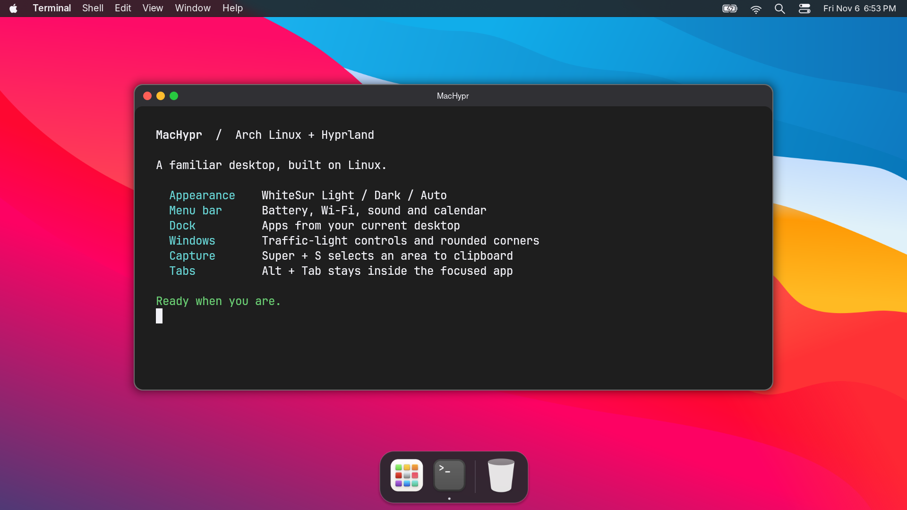
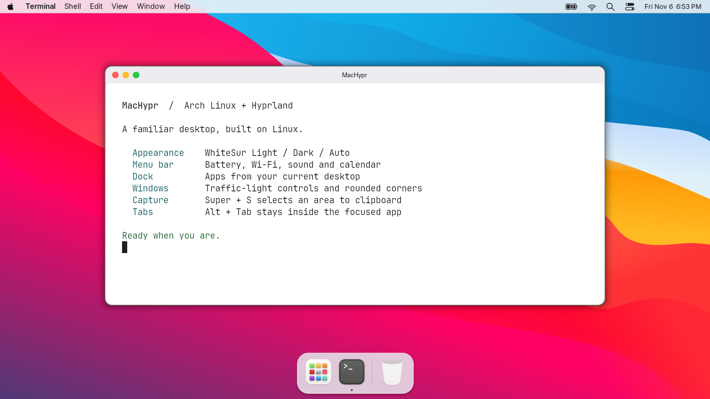
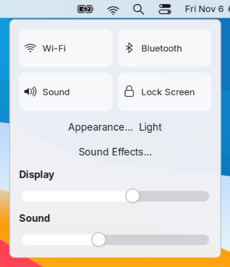
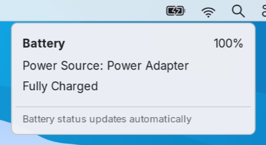
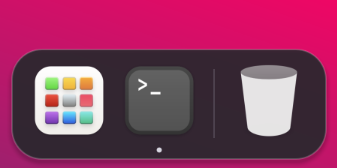
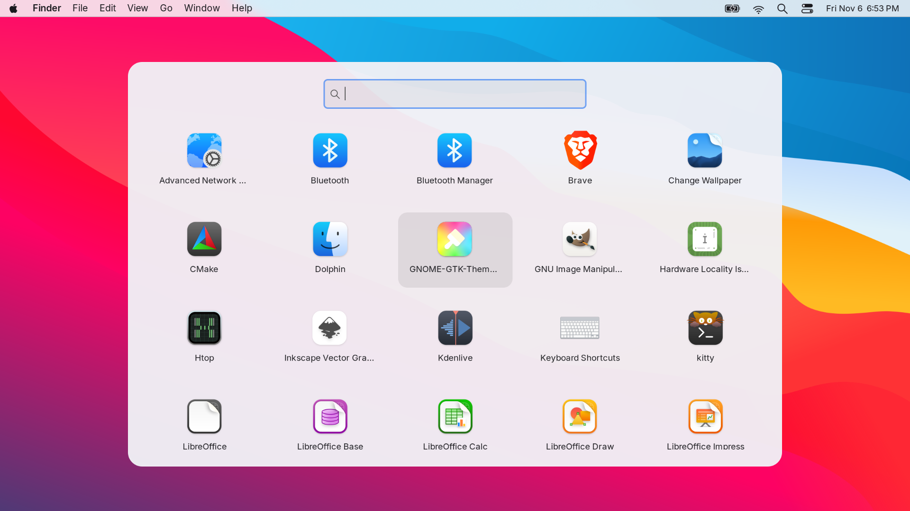
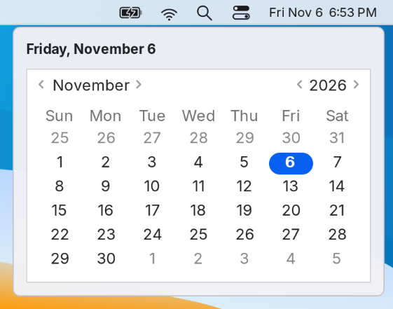
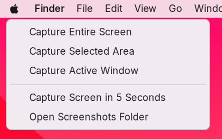

<div align="center">

# MacHypr

### A macOS-inspired desktop for Arch Linux and Hyprland.

MacTahoe styling with WhiteSur fallbacks. A native menu bar. A dock that follows your desktop.

[Install](#install) · [Gallery](#gallery) · [Shortcuts](#shortcuts) · [Documentation](docs/REFERENCE.md) · [Credits](docs/THIRD-PARTY.md)



</div>

## Install

On **Arch Linux x86_64**, run this as your regular user with sudo configured:

```bash
bash <(curl -fsSL https://raw.githubusercontent.com/yadavayush834/machypr/main/bootstrap.sh) --desktop-only
```

This installs the complete desktop setup: Hyprland dependencies, WhiteSur GTK themes and icons, menu bar, dock, window controls, fonts, screenshot tools, shortcuts and sound effects. Existing configuration is backed up before replacement. Log out and back in after installation.

**Compatibility:** the current Lua configuration and pinned window-decoration plugin target **Hyprland 0.57.x**. Internet, `curl`, and working sudo access are required. This configures an existing Arch installation; it does not install Arch or create a bootable OS image. Personal monitor rules are replaced with automatic display configuration.

<details>
<summary><strong>Preview, full workstation install, and other options</strong></summary>

Preview the desktop plan without installing packages or changing configuration:

```bash
bash <(curl -fsSL https://raw.githubusercontent.com/yadavayush834/machypr/main/bootstrap.sh) --desktop-only --dry-run
```

For the full workstation, including Brave, VS Code, office/creative applications, development tools and example projects, omit `--desktop-only`:

```bash
bash <(curl -fsSL https://raw.githubusercontent.com/yadavayush834/machypr/main/bootstrap.sh)
```

Or inspect the source and install locally:

```bash
git clone https://github.com/yadavayush834/machypr.git
cd machypr
./install.sh --desktop-only --dry-run
./install.sh --desktop-only
```

| Option | What it does |
| --- | --- |
| `--desktop-only` | Complete desktop styling and tools; skip extra workstation apps |
| `--dry-run` | Print the installation plan |
| `--config-only` | Apply configuration; assumes dependencies, themes and hyprbars are installed |
| `--no-activate` | Apply files without explicitly restarting desktop daemons |
| `--no-projects` | Skip React/Next.js starter projects in the full workstation install |

The bootstrap downloads this repository into a temporary directory and runs its installer. `MACHYPR_REF` can select a branch, tag or commit when running a downloaded copy of `bootstrap.sh`.

</details>

## What you get

| Part | How it works |
| --- | --- |
| **Menu bar** | Aligned Apple menu, active-app name, app shortcuts, Wi-Fi, real battery/charging state, Spotlight launcher and clock |
| **Dock** | Current-desktop apps, sharp WhiteSur icons, hover magnification and auto-hide; Launchpad and Trash remain available |
| **Window controls** | Red closes, yellow minimizes, green maximizes; centered titles and rounded corners |
| **Appearance** | Light, Dark or scheduled Auto, shared across desktop surfaces and supported app palettes |
| **Control Center** | Brightness and sound sliders, Wi-Fi, Bluetooth, screen lock, appearance and sound-effect controls |
| **Launchpad** | Searchable installed applications, kept ready in memory for faster repeat opens |
| **Dashboard** | On-demand local notes and system information with `Super + D` |
| **Screenshots** | `Super + S` selects an area and copies it to the clipboard without saving a file |
| **Window and tab switching** | Clickable window-name menu; `Alt + Tab` cycles windows on the current desktop |
| **Sound effects** | Notification, volume-key and screenshot feedback, with preview and enable/disable controls |

## Gallery

These are captures of the running desktop, using a clean demonstration terminal. The dock combines pinned everyday applications with apps from the current desktop.

### Light and dark, throughout the desktop

<table>
<tr><th>Dark</th><th>Light</th></tr>
<tr>
<td width="50%"></td>
<td width="50%"></td>
</tr>
</table>

Choose **Apple menu → Appearance** or **Control Center → Appearance**. Auto selects Light from 7 AM to 7 PM and Dark overnight. Terminal palettes and title text update together to preserve contrast.

### Control Center and battery status

<table>
<tr><th>Control Center</th><th>Battery</th></tr>
<tr>
<td width="50%"><a href="assets/machypr-control-center.png"></a></td>
<td width="50%"><a href="assets/machypr-battery.png"></a></td>
</tr>
</table>

### A dock for the desktop you are using

<p align="center"></p>

Finder, Code, Brave and Terminal remain pinned; installed Bruno, DBeaver, Meld and Gitg join automatically. Other apps appear when opened and disappear when closed or moved to another desktop. Clicking an app raises a local window; repeated clicks cycle its local windows. Minimized windows stay available through their original desktop’s dock. Move to the bottom edge or press `Super + Alt + D` to reveal it.

### Launchpad



Search and launch your installed applications with `Super + R`. The grid reflects what is installed on your machine; the desktop-only installer does not add the optional workstation applications.

### Calendar and screenshots

<table>
<tr><th>Calendar</th><th>Screenshot menu</th></tr>
<tr>
<td width="50%"><a href="assets/machypr-calendar.png"></a></td>
<td width="50%"><a href="assets/machypr-screenshot.png"></a></td>
</tr>
</table>

Click the clock for the calendar. Use `Super + S` for an area capture directly to the clipboard, or open screenshot options for screen/window capture and a five-second timer.

## Shortcuts

**Super** is the Windows/logo key, shown as ⌘ in desktop menus.

| Action | Shortcut |
| --- | --- |
| Spotlight application search | `Super + Space` |
| Launchpad | `Super + R` |
| Minimize / full screen | `Super + M` / `Super + Ctrl + F` |
| Terminal / file manager | `Super + Return` / `Super + E` |
| Browser / VS Code, when installed | `Super + B` / `Super + C` |
| Window switcher / close window | `Super + Tab` / `Super + W` |
| Next / previous window on this desktop | `Alt + Tab` / `Alt + Shift + Tab` |
| Area screenshot → clipboard only | `Super + S` |
| Screen / area / screenshot options | `Super + Shift + 3` / `4` / `5` |
| Clipboard-only screen / area | Add `Ctrl` to the screen/area screenshot shortcuts |
| Reveal or hide dock | `Super + Alt + D` |
| Move / resize a window | `Super + left drag` / `Super + right drag` |
| Change desktop | `Super + 1–9` |
| Send window to desktop | `Super + Shift + number`; use `Super + Alt + Shift + 3/4/5` for desktops 3–5 |
| Control Center / wallpaper | `Super + Alt + B` / `Super + Alt + W` |
| Lock screen | `Super + L` |

Screenshot shortcuts other than the clipboard-only variants save to `~/Pictures/Screenshots` and copy to the clipboard. Escape cancels region selection.

## Restore and maintain

Restore the most recent backed-up configuration:

```bash
~/.local/bin/arch-rice-restore
```

Backups and install logs retain the compatible path `~/.local/state/arch-hyprland-dotfiles/`. Restoration covers managed configuration and saved session settings; installed packages, fonts, themes and generated projects remain installed. See the [full guide](docs/REFERENCE.md) for details.

After a Hyprland upgrade, rebuild the title-bar plugin from your local clone and log in again:

```bash
bash scripts/install-window-controls.sh
```

The pinned plugin currently supports 0.57.x. Newer Hyprland series need a matching source revision. Some applications cache palettes or draw their own controls and may need reopening or their native-title-bar setting. Brave uses integrated GTK controls; VS Code uses its native title bar.

## Validation and credits

```bash
bash scripts/check.sh
```

Checks cover portable apply/restore, backups, appearance contrast, battery states, screenshots, Brave launch settings and workspace-aware dock behavior. Live GTK checks additionally cover popup dismissal and mouse selection of overlapping/minimized windows. The desktop has been exercised on Hyprland 0.57.1; the complete privileged installation has not yet been verified on a second clean machine.

Built around [Hyprland](https://github.com/hyprwm/Hyprland), [WhiteSur](https://github.com/vinceliuice/WhiteSur-gtk-theme), GTK, Cairo and the official [hyprbars](https://github.com/hyprwm/hyprland-plugins/tree/main/hyprbars) plugin. Inter substitutes for San Francisco. The menu bar sends common app shortcuts rather than exporting native macOS menus.

Original configuration and helpers are [MIT licensed](LICENSE). Upstream assets keep their own licenses; see [third-party credits](docs/THIRD-PARTY.md). Sound samples are downloaded locally rather than bundled. MacHypr is an independent Linux desktop configuration, unaffiliated with Apple, Arch Linux or Hyprland.

### Desktop refinements

The menu bar uses cached status artwork and asynchronous active-window queries.
Spotlight searches installed applications with arrow-key selection, Return to open,
and Escape or an outside click to close. The dock eases its reveal and magnification
and stops frame callbacks when idle; it respects GTK's reduced-animation setting.
Volume and brightness keys show a short, non-focusing HUD alongside existing sound feedback.
Windows use click-to-focus, with Super+M to minimize and Super+Ctrl+F for full screen.
This remains a Big Sur-inspired Linux desktop: Spotlight currently searches apps,
and application menus remain shortcut adapters rather than native exported menus.

### Wi-Fi and desktop files

The Wi-Fi dropdown lists nearby iwd networks with signal strength, security,
and connected status, including while Ethernet is active. It refreshes in the
background. Select a network to connect using iwctl's password prompt;
Wi-Fi Settings retains the full iwd setup interface.

Desktop icons show the contents of `~/Desktop` and update when files change.
Double-click an icon or select it and press Return to open it. The first run
adds shortcuts for installed Finder, Browser, Terminal and Code apps, plus
Documents, Downloads and Projects folder links. Right-click for New Folder
or Open Desktop Folder. Shortcuts are seeded once, so removing them sticks.

Desktop icons can be dragged freely across the wallpaper. Coordinates are saved
in `~/.local/state/macos-desktop/icon-positions.json` and restored on login.
Charging below 100% uses a green pulsing battery; full, discharging and
plugged-but-not-charging batteries use the static normal indicator.

Brave uses the same Hyprland traffic-light title bar as other windows. Restart
Brave after applying the configuration so its built-in window buttons are hidden.

### Optional Liquid Glass appearance

Open **Apple menu → Liquid Glass…** or **Control Center → Liquid Glass…**,
then select **Yes** or **No**. The preference persists across logins and is
independent of Light/Dark appearance. Yes enables blurred translucent shell
surfaces, highlighted edges, pointer-responsive dock lighting, translucent
shared title bars and eased window entrances. No restores standard styling.
Application content remains opaque.

This is a native GTK/Cairo/Hyprland approximation inspired by
[iyinchao/liquid-glass-studio](https://github.com/iyinchao/liquid-glass-studio),
not Apple's compositor or the reference's WebGL/WebGPU renderer. It does not
implement optical refraction, chromatic dispersion, merging glass shapes,
or change third-party app interiors.

## November 7 desktop update

The current setup adds Tahoe themes and icons, a local Dashboard, developer app pins, smoother Alt+Tab window cycling, simpler title-bar dragging, a lighter lock screen, lid-open display activation and optional faster suspend. Launchpad stays ready in memory, search updates without a debounce delay, and the dock queries Hyprland directly. A low-priority user timer warms up to 768 MiB of common application files after sign-in; these pages are reclaimable when other programs need RAM.

Measured on the development laptop: repeat Launchpad opens took about 70–75 ms, compared with 600–770 ms before. These are launcher visibility timings, not timings for every application. Actual application startup still depends on storage and the application.

The standard installer applies portable user files. System-wide lid handling, faster sleep and guarded login sessions are optional: see [system setup and today's changes](docs/2026-11-07.md). Hardware-specific F11/F12 workarounds are examples and are not enabled for other users.
